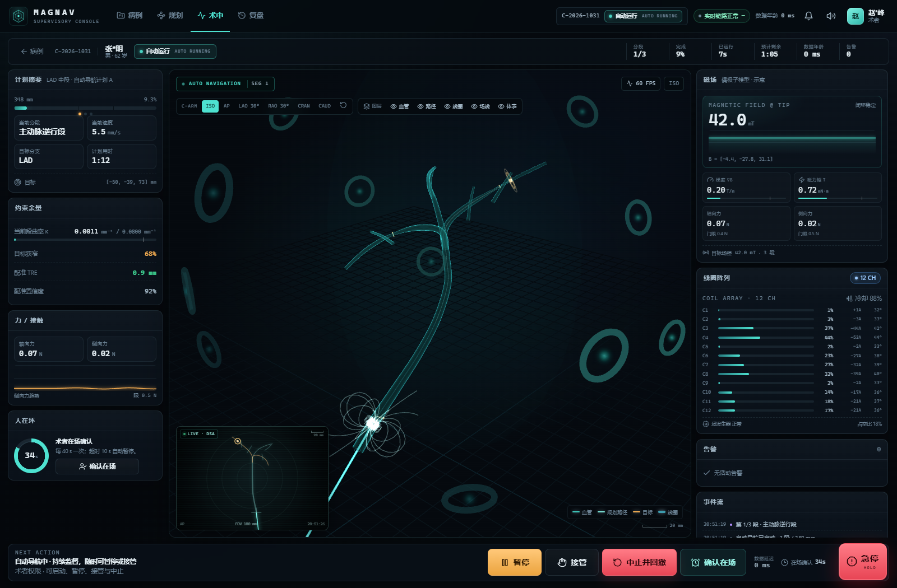

# MAGNAV · 磁控介入手术机器人监督控制台

> **Web 全栈研究原型**：React 18 + Three.js 监督控制台 + Node.js 实时服务 + 确定性机器人/磁场模拟器。
> 按 `plan/磁控介入手术机器人前端方案.md` 实现，**不使用 Electron 桌面壳**。



> ⚠️ **研究用原型，非医疗器械。** 所有患者、影像、磁场、机器人与告警均为确定性模拟数据，不得用于临床诊断或治疗。

---

## 1. 现在能做什么

| 主线 | 已实现 |
|---|---|
| **术前规划** | 病例列表 / 新建脱敏病例 · 程序化血管树 · 分支或 3D 选点 · 路径求解 · 曲率与磁可行性校验 · 分段与速度计划 · 审核签字 · 配准复核 |
| **术中监督** | 实时 3D（血管 / 导管 / 目标 / 12 线圈 / 场线 / 2D DSA）· 120 Hz 遥测 · 数据年龄与冻结 · 磁场 / 梯度 / 力矩 / 力 · 12 路线圈电流与温升 · 分级告警 · 事件流 |
| **安全交互** | 飞行前预检 · 术者 + 助手双人确认武装 · 启动二次确认 + 800 ms 长按 · 人在环定时确认 · 暂停 / 继续 / 接管 / 中止回撤 · 软件急停与复位 · 链路看门狗 |
| **复盘与合规** | 全量帧回放（位姿 / 梯度 / 力 / 进度）· 事件时间轴 · 偏差与耗时统计 · JSON 报告导出 · SHA-256 哈希链审计 · 审计包导出 |
| **设备与故障** | 线圈自检 · 跟踪器 / 急停 / 冷却状态 · 多客户端同步 · 故障注入（配准超限 / 力超限 / 线圈饱和 / 梯度 / 链路） |
| **角色权限** | 术者 / 助手 / 影像技师 / 临床工程师 / 质控审核，RBAC 在服务端强制 |

### 关键实现取舍

- **前端不参与闭环**：控制台只发送高层意图（`START_AUTO` / `PAUSE` / `TAKEOVER` / `ABORT` / `ESTOP`），由服务端权威状态机裁决。
- **高频数据不进 React**：遥测在 Worker 解码，进入模块级环形缓冲；3D 在 `useFrame` 直读，HUD 以 10 Hz 订阅。
- **单一 WebSocket 复用**：二进制遥测 + JSON 事件/命令走同一条 `/ws/v1`，避免双通道状态漂移（与方案「不要两套命令通道」的原则一致）。
- **服务端权威状态机**：xstate v5 机器定义在 `@magnav/protocol` 共享，服务端持有唯一实例；前端只做展示与本地可用性提示。
- **确定性模拟器**：同一套偶极子场模型用于可行性检查、线圈电流求解和遥测合成；无硬件也能开发、演示与回放。
- **实时层网关边界**：服务端只依赖 `RobotGateway` 接口，模拟器是默认实现；真实 1 kHz 实时层可按同一契约接入，见 [`docs/INTEGRATION.md`](docs/INTEGRATION.md)。
- **SQLite 持久化**：病例、计划、配准、会话（含状态机事件、告警、复盘轨迹）落库；服务重启后自动恢复，运动保持暂停并产生 `SERVICE_RESTART` 告警。

---

## 2. 快速开始

要求：Node.js ≥ 22.13（仓库在 Node 24 / Windows 11 下验证；使用内置 `node:sqlite`，无需原生编译）。

```bash
npm install

# 开发：API + WS 在 8810，Vite 在 5173（/api 与 /ws 已代理）
npm run dev

# 生产构建 + 单端口运行
npm run build
npm start
# → http://127.0.0.1:8810
```

其他命令：

```bash
npm test            # Vitest：协议 / 服务端门禁 / 持久化 / 网关（50 项）
npm run test:e2e    # 构建 + Playwright：登录、审批、术中安全流程、复盘与审计（4 项）
npm run typecheck   # 三个 workspace 全量 strict typecheck
npm run smoke       # 无浏览器端到端：登录 → 建会话 → 预检 → 武装 → 遥测 → 暂停 → 急停 → 复盘
```

> E2E 默认使用系统 Chrome；无 Chrome 的机器先执行 `npx playwright install chromium`。

运行数据默认写入 `data/`（已 gitignore）：

| 文件 | 内容 |
|---|---|
| `data/magnav.sqlite` | 病例、计划、配准、会话、状态机事件、告警、复盘帧 |
| `data/audit.jsonl` | 追加式 SHA-256 哈希链审计 |
| `data/debug.sqlite` / `data/debug-audit.jsonl` | F5 调试实例（与生产隔离） |

首次启动会播种 3 个演示病例和归档复盘；之后 DB 非空时不会重复播种。服务重启时会话恢复为暂停态，必须确认现场后手动继续。

### 持久化与会话恢复

- 服务端在命令、阶段变化、告警、在场确认和每 2 s 的 tick 中持久化会话；重启时重放状态机事件恢复上下文。
- 处于 `AUTO_RUNNING` 的会话在恢复时被强制转为 `AUTO_PAUSED`，并产生高危 `SERVICE_RESTART` 告警。
- 前端刷新或重新登录后通过 `activeSessionId` 自动回到当前会话，不新建会话。
- 数据库路径可用 `MAGNAV_DB_PATH` 覆盖；调试实例自动使用独立 DB 和审计文件。

### VS Code 按 F5 调试

在 **仓库根目录** 打开 VS Code，直接按 `F5`。默认配置「`▶ MAGNAV 全栈调试（F5）`」会：

- 在 **5174** 启动 Vite（HMR），在 **8820** 启动 API + WebSocket；
- 自动打开 Chrome 调试会话；
- 支持 `apps/server/src/**`、`packages/protocol/src/**` 与 `apps/console/src/**` 的 TypeScript 断点。

F5 调试端口与生产 `8810` 隔离，**可以同时保留 `npm start` 的实例**。

调试下拉还提供：仅服务端、附加 tsx watch、仅 Chrome、Vitest 当前文件 / 全部、生产构建调试。
完整说明与端口排查见 [`docs/DEBUGGING.md`](docs/DEBUGGING.md)。

> 开发服务器默认 `HOST=127.0.0.1`、`PORT=8810`。生产构建由 Fastify 直接托管 `apps/console/dist`，并使用 CSP、HttpOnly Cookie 与同源 CSRF 校验。

### 演示账号

| 角色 | 姓名 | 工牌 | 口令 | 权限 |
|---|---|---|---|---|
| 术者 | 赵\*峰 | `M-1042` | `2468` | 计划审核、武装、启动、暂停、接管、中止、急停 |
| 助手 | 李\*婷 | `M-1087` | `1357` | 双人确认、暂停、急停、告警确认 |
| 影像技师 | 王\*磊 | `T-2011` | `8642` | 影像 / 配准、预检、只读观察 |
| 临床工程师 | 陈\*涛 | `E-3007` | `1122` | 设备、审计、故障注入 |
| 质控审核 | 周\*敏 | `Q-4003` | `4455` | 复盘、审计、只读 |

登录页支持点击演示账号自动填入，便于评审。

---

## 3. 五分钟演示路径

1. **术者登录** → 打开 `C-2026-1031`（LAD 中段重度狭窄）。
2. **术前规划**：左侧选择 LAD，点击「生成导航计划」，查看 3D 路径、分段、曲率与磁可行性；点击「审核签字」，输入 `2468`。
3. **进入术中**：预检 9 项全绿 → 「双人确认武装」，助手工牌 `M-1087` / 口令 `1357` → 「启动自动导航」，勾选确认并按住 0.8 s。
4. **监督**：观察导管沿路径推进、场强 / 梯度 / 线圈电流实时变化；每 ~40 s 点击「确认在场」以维持人在环。
5. **异常处置**（第二个浏览器，工程师 `E-3007`）：
   - 从术中页进入「设备」→「故障注入」→「线圈饱和」；
   - 术者屏在 1 s 内出现高危告警与自动暂停；确认告警后「继续」；
   - 按住「急停」→ 急停锁定 → 「复位急停」→「中止并回撤」。
6. **复盘**：完成后进入复盘，拖动时间轴、查看梯度 / 力 / 进度曲线、事件与审计哈希；导出 JSON。
7. **审计**：设备页 →「审计哈希链」→ 重新校验 / 导出 NDJSON。

完整步骤与预期结果见 [`docs/DEMO.md`](docs/DEMO.md)。

---

## 4. 架构一页图

```
┌──────────────────────────── Browser ────────────────────────────┐
│ React 18 SPA                                                     │
│  ├─ pages: login / cases / planning / procedure / review / admin │
│  ├─ features/stores: session / UI / alarms                       │
│  ├─ scene: R3F + Three.js（血管、导管、线圈、场线、DSA）           │
│  └─ telemetry: Worker 解码 → 环形缓冲 → 插值 → useFrame / 10 Hz   │
└───────────────▲───────────────────────────┬─────────────────────┘
                │ binary telemetry          │ JSON events / commands
                │ (120 Hz)                  │ (ack / ack-timeout)
        ┌───────┴───────────────────────────▼─────────┐
        │ Fastify + ws @ :8810                        │
        │  ├─ auth / CSRF / RBAC                       │
        │  ├─ authoritative xstate procedure machine   │
        │  ├─ command idempotency + acknowledgements   │
        │  ├─ simulator: kinematics + dipole field     │
        │  ├─ precheck / alarms / deadman / watchdog   │
        │  └─ SHA-256 audit chain → data/audit.jsonl   │
        └─────────────────────────────────────────────┘
```

更完整的协议、坐标、状态机、性能与安全设计见 [`docs/ARCHITECTURE.md`](docs/ARCHITECTURE.md)。

---

## 5. 仓库结构

```
magnav-web/
├─ apps/
│  ├─ console/              React 18 + Vite + R3F 控制台
│  │  ├─ src/pages/         login / cases / planning / procedure / review / admin
│  │  ├─ src/scene/         LPS↔scene、血管网格、导管管线、线圈、场线、相机
│  │  ├─ src/telemetry/     环形缓冲、插值、Worker
│  │  ├─ src/services/      HTTP、WebSocket、时钟同步、音频
│  │  └─ src/store/         zustand 会话与 UI 状态
│  └─ server/               Fastify 实时服务 + 模拟器 + 审计
│     ├─ src/planning.ts    路径图求解、偶极子可行性、分段
│     ├─ src/simulator.ts   确定性运动学 / 磁场 / 线圈电流 / 回撤
│     ├─ src/service.ts     权威状态机、命令门禁、预检、告警、看门狗
│     ├─ src/seed/          病例、血管树、配准、演示复盘数据
│     └─ src/ws.ts          单路复用 WebSocket
├─ packages/protocol/       共享类型、二进制编解码、xstate 机器、几何/场模型
├─ scripts/ws-smoke.ts      无浏览器端到端冒烟
├─ docs/                    架构 / 安全 / 演示 / 验证
└─ plan/                    原始前端技术方案
```

---

## 6. 与原方案的对照

| 方案条目 | 本实现 | 说明 |
|---|---|---|
| Electron 桌面壳 | **改为 Web 全栈** | 按需求移除；Fastify 单端口托管 + CSP，便于院内部署与评审 |
| three.js + R3F v8 | ✅ | 锁定 React 18.3 / R3F 8.17 / three 0.169 |
| 高频遥测不进 React | ✅ | Worker 解码 + 256 帧环形缓冲 + 40 ms 渲染插值 + 10 Hz HUD |
| xstate 驱动流程 | ✅ | `packages/protocol/src/machine.ts`，服务端唯一实例 |
| 自动模式全程人在环 | ✅ | 预检、双人武装、启动二次确认 + 长按、deadman、看门狗、急停 |
| 二进制 WebSocket 协议 | ✅ | 自定义 20 B 帧头 + 1.3 KB 固定布局负载；单通道复用事件/命令 |
| DICOM / Cornerstone3D | **合成 DSA** | 无真实 DICOM 数据；2D 面板由同一中心线数据投影生成，聚焦于交互与降级路径 |
| Ant Design 5 | **自绘 UI** | 暗色手术室设计系统 + 触摸尺寸 + 告警分级，避免组件库风格冲突 |
| 双 WebSocket 通道 | **单路复用** | 减少双连接状态漂移；命令/事件/遥测同一鉴权上下文 |
| 1 kHz 实时闭环 | **不实现** | 明确由实时层负责；前端模拟器为演示用 |
| 生产级身份 / DICOM / 硬件 | **模拟** | 见「已知限制」 |

---

## 7. 安全边界（必须保留）

> 前端是「信息呈现与意图输入」通道，**不是**安全相关控制的唯一实现。所有可能导致伤害的动作，其安全性由实时层安全包络、硬件急停和看门狗保证；前端失效时系统必须进入安全状态。

本实现遵循：

- 链路丢失 5 s → 自动暂停并保持位置；
- 位姿数据年龄 > 200 ms → 3D 冻结并显式标注，禁止自动导航继续；
- 命令 2.5 s 无 ack → 显示「未确认」，以服务端广播为准；
- 预检未全绿 / TRE > 1.5 mm / 计划未签字 → 禁止武装或启动；
- 急停锁定 → 所有运动指令拒绝，需术者二次确认复位；
- 审计只追加，任何回溯修改都会破坏哈希链。

详细威胁与 FMEA 见 [`docs/SAFETY.md`](docs/SAFETY.md)。

---

## 8. 验证

- `npm test`：**50 项全部通过**（协议编解码 / 状态机 / 几何 / 场模型 / 导航图 / 服务端门禁 / 持久化恢复 / 网关工厂 / 坐标基变换）。
- `npm run test:e2e`：**4 项 Playwright 通过**（登录与病例、计划审批、术中安全链路、复盘与审计校验）。
- `npm run typecheck`：三个 workspace 0 error（strict）。
- `npm run build`：Vite 生产构建 + tsup 服务端 bundle 成功。
- CI：`.github/workflows/ci.yml` 在 Node 24 上执行 typecheck、单测、构建与 Playwright。
- 浏览器验证：登录、病例、规划、审批、3D 选点、预检、双人武装、启动、120 Hz 遥测、暂停、故障注入（第二客户端）、急停 / 复位、中止、完成、复盘、审计导出。
- 生产模式验证：`http://127.0.0.1:8810` 单端口、CSP、Worker、WS、Cookie 鉴权均通过。

更细的测试矩阵见 [`docs/VERIFICATION.md`](docs/VERIFICATION.md)。

---

## 9. 已知限制

- 单进程 SQLite；已支持重启恢复，但未实现多实例并发写与跨节点一致性。生产建议迁移 PostgreSQL + 会话锁。
- 模拟器为确定性运动学，不包含导管-血管接触力学、血液流变或真实磁线圈耦合。
- `MAGNAV_GATEWAY=external` 目前为 fail-fast 占位；真实实时层适配器需按 [`docs/INTEGRATION.md`](docs/INTEGRATION.md) 实现。
- 2D DSA 为合成投影，不是 DICOM 查看器；未集成 Cornerstone3D。
- 登录为本地口令 + HttpOnly Cookie；未接医院 LDAP / 双因素。
- 未实现 5 分钟无操作自动锁屏（方案中的建议项）。
- 未实现专用助手屏 / 影像屏布局；多客户端通过同一控制台与 RBAC 只读实现同步。
- 真实硬件在环、故障注入台架、可用性总结性评估不在本原型范围内。

---

## 10. 文档

- [`docs/ARCHITECTURE.md`](docs/ARCHITECTURE.md) — 分层、协议、坐标、场景、状态机、性能
- [`docs/SAFETY.md`](docs/SAFETY.md) — 安全论证边界、危害与控制、审计
- [`docs/DEMO.md`](docs/DEMO.md) — 演示脚本与预期现象
- [`docs/DEBUGGING.md`](docs/DEBUGGING.md) — VS Code F5、断点、端口与附加调试
- [`docs/INTEGRATION.md`](docs/INTEGRATION.md) — `RobotGateway` 契约、实时层接入与协议 v2 计划
- [`docs/VERIFICATION.md`](docs/VERIFICATION.md) — 测试与验收记录
- [`plan/磁控介入手术机器人前端方案.md`](plan/磁控介入手术机器人前端方案.md) — 原始方案

---

## 11. 许可

见 [LICENSE](LICENSE)。仅用于研究与教学演示，不构成医疗器械或临床软件。
